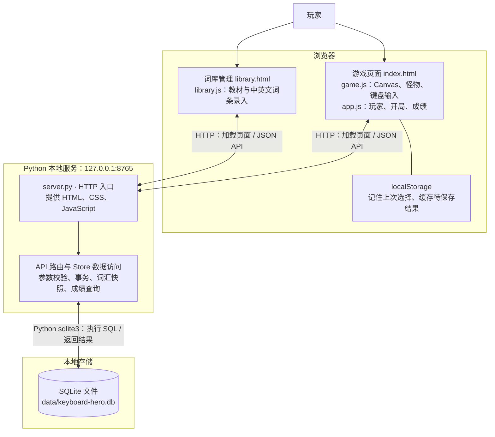

# 键盘勇者：本地系统架构

依据当前代码整理，日期：2026-10-25。

整个程序运行在同一台电脑上。浏览器负责游戏与页面交互，Python 服务负责读取词库、记录成绩，SQLite 将数据保存到本地文件。

## 如何连接

1. 在项目目录执行 `python3 server.py`。服务启动时根据 `schema.sql` 创建数据库和表，并监听 `127.0.0.1:8765`。
2. 浏览器访问 `http://127.0.0.1:8765`，Python 服务返回页面、样式与 JavaScript。词库管理页面通过同一个服务访问。
3. 页面使用 `fetch('/api/...')` 请求数据；读取使用 GET，写入使用 POST，业务数据以 JSON 传递。
4. `server.py` 校验请求，由 `Store` 使用 Python 自带的 `sqlite3` 库执行 SQL。写操作在事务中完成，结果再以 JSON 返回浏览器。

**SQLite 不需要独立启动数据库服务，也没有数据库端口。浏览器不直接连接数据库，只有 Python 服务读写数据库文件。**

## 三条主要业务链路

| 场景 | 浏览器 → Python 接口 | 数据库操作与返回结果 |
| --- | --- | --- |
| 录入教材词库 | `POST /api/textbooks`、`POST /api/lists` | 保存教材、词表、英文单词及中文释义 |
| 开始游戏 | `POST /api/players`、`POST /api/sessions` | 查找／创建玩家，创建对局并保存词汇快照；返回本局词汇及难度与提示比例配置 |
| 结算与查成绩 | `POST /api/sessions/:id/finish`；`GET /api/stats`、`GET /api/leaderboard` | 保存结果；查询历史、个人纪录与同条件排行榜 |

游戏开始后，怪物移动、Canvas 绘制、单词匹配与攻击判定都在浏览器执行，不会逐帧请求服务器。正常结束时上报成绩；切换模式或离开页面时尝试记录为中断。

## 数据保存在哪里

SQLite 中共有 8 张表，分成三组：

- 玩家：`players`。
- 教材词库：`textbooks`、`word_lists`、`words`、`word_list_items`。
- 对局与快照：`game_sessions`、`session_word_lists`、`session_words`。

历史对局保存当时使用的英文、中文释义及词表名称，之后编辑教材不会改写旧对局。最高分由已结算对局查询计算，不单独维护最高分表。

浏览器的 `localStorage` 只用于玩家／词表及难度与提示比例配置记忆、待保存结果缓存，以及离线模式的最高分；完整版本以 SQLite 中的记录为准。

## 直接打开 HTML 时

直接双击 `index.html` 或 `keyboard-hero.html`，可以运行内置词库游戏，但不会连接 SQLite。教材管理、玩家历史及数据库排行榜需要启动 Python 服务，并通过本地 HTTP 地址访问。
